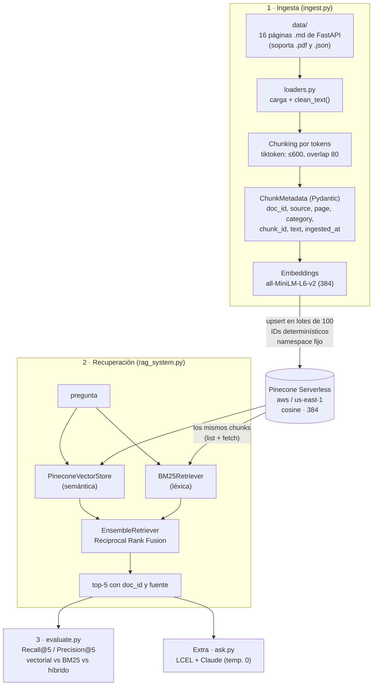

# Sistema RAG escalable en la nube con Pinecone

**Pre-entrega 4 · AI Engineering (Coderhouse).** Un sistema de recuperación de información sobre la documentación oficial de **FastAPI**. Los documentos se fragmentan, se convierten en vectores y se guardan en **Pinecone Serverless**, en la nube. Las búsquedas combinan dos estrategias: la **semántica**, con embeddings, y la **léxica**, con BM25, unidas en un `EnsembleRetriever` de LangChain. La calidad de la búsqueda se mide con **Recall@5** y **Precision@5** sobre un golden set.

Como extra, `ask.py` responde preguntas con **Claude**: usa los fragmentos recuperados y cita las fuentes tomándolas de la metadata.

---

## Arquitectura



| Archivo | Qué hace |
|---|---|
| `config.py` | Toda la configuración en un solo lugar: claves del `.env`, modelo, chunking, top-k y pesos. `requerir()` corta con un mensaje claro si falta una variable. |
| `download_docs.py` | Baja 16 páginas de la doc de FastAPI desde GitHub, fijadas a un commit para que el dataset sea siempre el mismo. Reemplaza los marcadores `{* ... *}` por el código real de cada ejemplo. |
| `loaders.py` | Carga `.md`, `.pdf` (una página por Document) y `.json` (un ítem por Document), y los limpia con `clean_text()`. La categoría sale de la subcarpeta (`tutorial`, `advanced`). |
| `schemas.py` | `ChunkMetadata`: metadata estricta de Pydantic (`strict=True`, `extra="forbid"`). `Resultado`: lo que devuelve `retrieve()`. |
| `pinecone_utils.py` | Piezas compartidas: el modelo de embeddings (uno solo), la medición de la dimensión, el cliente de Pinecone y `abrir_indice()`, que verifica que el índice exista, esté listo y tenga la dimensión correcta. |
| `setup_index.py` | Crea el índice Serverless si no existe, espera a que esté listo y valida la dimensión. |
| `ingest.py` | Chunking, metadata validada, embeddings, upsert por lotes y `describe_index_stats()`. |
| `rag_system.py` | Clase `RAGSystem` con `retrieve(query, k=5, modo, category)`. |
| `golden_set.json` | 5 preguntas con el documento que debería aparecer como respuesta. |
| `evaluate.py` | Calcula Recall@5 y Precision@5 por pregunta y en promedio, para 3 modos. |
| `ask.py` | (Extra) Cadena LCEL: `RAGSystem` + prompt + Claude + fuentes tomadas de la metadata. |
| `resultados_evaluacion.txt` | La salida completa de `evaluate.py` en una corrida real. |

Los documentos de `data/` son páginas de la [documentación oficial de FastAPI](https://fastapi.tiangolo.com/) (© Sebastián Ramírez, licencia MIT), descargadas tal cual con `download_docs.py`.

---

## Cómo replicarlo paso a paso

Requisitos: **Python 3.10 a 3.13**. `langchain-pinecone` todavía no soporta Python 3.14; en Windows se puede instalar 3.13 al lado con `py install 3.13`.

### 1. Crear la cuenta de Pinecone y la API key
1. Registrate gratis en https://app.pinecone.io. El plan Starter alcanza: incluye índices Serverless en `aws/us-east-1`.
2. En el menú de la izquierda andá a **API Keys** → **Create API key**, ponele un nombre y copiá la clave (empieza con `pcsk_`).
3. (Solo para `ask.py`) Creá una clave de Anthropic en https://console.anthropic.com → **API Keys**.

### 2. Descargar el proyecto e instalar
```bash
git clone https://github.com/anukvilarasau/pre-entrega-4.git
cd pre-entrega-4

python -m venv .venv                 # en Windows con varias versiones: py -V:3.13 -m venv .venv
.venv\Scripts\activate               # en Mac/Linux: source .venv/bin/activate
pip install -r requirements.txt
```

### 3. Completar el `.env`
```bash
copy .env.example .env               # en Mac/Linux: cp .env.example .env
```
Abrí `.env` y completá:
```ini
PINECONE_API_KEY=pcsk_...
ANTHROPIC_API_KEY=sk-ant-...
INDEX_NAME=fastapi-docs
PINECONE_NAMESPACE=fastapi-v1
```
El `.env` está en `.gitignore` y nunca se sube.

### 4. Correr el pipeline
```bash
python download_docs.py    # (opcional: data/ ya viene en el repo) baja las 16 páginas
python setup_index.py      # crea el índice Serverless (384, cosine) y espera a que esté listo
python ingest.py           # sube los 101 fragmentos y muestra describe_index_stats()
python evaluate.py         # reporte Recall@5 / Precision@5
```
Extras:
```bash
python rag_system.py "How do I enable CORS?" tutorial     # top-5 en los 3 modos, filtrando por category
python ask.py "How do I allow my React frontend on localhost:3000 to call my API?"
python ask.py                                             # modo interactivo
```

Uso desde código:
```python
from rag_system import RAGSystem

rag = RAGSystem()
for r in rag.retrieve("Why use lru_cache with Settings?", k=5, category="advanced"):
    print(r.posicion, r.doc_id, r.source)
```

---

## Resultados

### Ingesta (corrida real)
```
Documentos cargados: 16 archivos (16 páginas/ítems)
Fragmentos: 101 (tokens por fragmento: mín 45, promedio 432, máx 594; techo 600, overlap 80)
  Lote 1: vectores 1-100 de 101 subidos
  Lote 2: vectores 101-101 de 101 subidos

describe_index_stats():
{'dimension': 384, 'metric': 'cosine',
 'namespaces': {'fastapi-v1': {'vector_count': 101}},
 'total_vector_count': 101, 'vector_type': 'dense'}
```
Si se vuelve a correr `ingest.py`, el conteo **sigue en 101**: los IDs determinísticos sobrescriben los mismos vectores en lugar de duplicarlos.

### Evaluación (k = 5)

| Pregunta | Tipo | Esperado | Vectorial R / P | BM25 R / P | Híbrido R / P |
|---|---|---|---|---|---|
| P1 · ejecutar algo después de devolver la respuesta | semántica | `background-tasks` | 1 / 0.40 | 1 / **0.60** | 1 / **0.60** |
| P2 · por qué `@lru_cache` en `Settings` | término exacto | `settings` | 1 / 1.00 | 1 / 1.00 | 1 / 1.00 |
| P3 · query param opcional de máx. 50 caracteres | semántica | `query-params-str-validations` | 1 / 0.80 | 1 / 0.60 | 1 / 0.80 |
| P4 · conexión bidireccional en tiempo real | semántica | `websockets` | 1 / 1.00 | 1 / 0.80 | 1 / 1.00 |
| P5 · qué hace `response_model_exclude_unset` | término exacto | `response-model` | 1 / 1.00 | 1 / 0.60 | 1 / 0.80 |
| **Promedio** | | | **1.00 / 0.84** | **1.00 / 0.72** | **1.00 / 0.84** |

R = Recall@5 (1 si el documento correcto aparece entre los 5). P = Precision@5 (proporción de los 5 fragmentos que son del documento correcto). El detalle completo está en [`resultados_evaluacion.txt`](resultados_evaluacion.txt).

**Lectura de los resultados:**
- **Recall perfecto en los tres modos.** Con 16 documentos de temas bien separados, ninguna estrategia "pierde" el documento correcto. El golden set es chico y no alcanza para separar los modos por recall.
- **Las diferencias aparecen en la precisión.** El híbrido iguala al mejor modo en promedio (0.84, igual que el vectorial) y supera a BM25 solo (0.72). Al combinar los dos rankings, el híbrido nunca queda por debajo del peor de los dos.
- **P1 muestra el aporte de BM25.** El vectorial trae 2 fragmentos de `websockets` ("enviar mensajes") en lugar de `background-tasks`. BM25 encuentra las palabras exactas *email*, *notification* y *response*, y el híbrido sube a 0.60. **Ese es el techo posible**: `background-tasks` tiene solo 3 fragmentos, así que como mucho 3 de 5 pueden ser de ese documento.
- **En P5, BM25 solo fue peor que el vectorial.** El término `response_model_exclude_unset` está en el documento correcto, pero el tokenizador de BM25 (`\w+`) lo deja como una sola palabra rara. Las otras palabras de la pregunta (*what*, *does*, *true*) aparecen en todos lados y suman fragmentos de otros documentos. El híbrido compensa y queda en 0.80.

---

## Errores evitados

**Dimensiones.**
- La dimensión del índice no se escribe a mano: `setup_index.py` la **mide** generando un embedding real con el modelo (384).
- Si el índice ya existe con otra dimensión, `setup_index.py`, `ingest.py` y `RAGSystem` cortan con un mensaje claro. Se probó creando un índice de 1536 dimensiones:
  > `ERROR: El índice 'pe4-prueba-dim' tiene dimensión 1536, pero el modelo sentence-transformers/all-MiniLM-L6-v2 genera vectores de 384. No son compatibles.`
- Hay **un solo modelo de embeddings** (`pinecone_utils.get_embeddings()`) y lo usan tanto la ingesta como la consulta.

**Namespaces.**
- Todo upsert y toda consulta usan `PINECONE_NAMESPACE`, nunca el namespace por defecto (`""`). Así se pueden tener varias versiones del dataset en el mismo índice sin mezclarlas.
- Si el namespace está vacío, `RAGSystem` lo avisa (`El namespace 'x' está vacío. Cargá los documentos con: python ingest.py`) en lugar de devolver resultados vacíos sin explicación.
- BM25 se arma con los fragmentos **leídos del mismo namespace de Pinecone** (`index.list()` + `index.fetch()`). Así BM25 y el buscador vectorial trabajan siempre sobre los mismos chunks, aunque cambien los archivos locales.

**Tamaño de los chunks.**
- El chunking se mide en **tokens** (tiktoken `cl100k_base`), no en caracteres: techo de 600 y overlap de 80, dentro del rango de 500 a 800 que pide la consigna. Se usan separadores de Markdown, así que los cortes caen primero en títulos y bloques de código.
- **Límite del modelo:** `all-MiniLM-L6-v2` solo lee los primeros **256 tokens** de su propio tokenizador. 89 de los 101 fragmentos son más largos, así que su embedding representa sobre todo el comienzo del fragmento. Por eso conviene el híbrido: **BM25 sí lee el fragmento completo**. Con más tiempo, convendría probar chunks más chicos o un modelo con más contexto, como `all-mpnet-base-v2` (384 tokens, 768 dimensiones, lo que obliga a recrear el índice).
- El texto original de cada fragmento (~3 KB) va dentro de la metadata, muy por debajo del límite de 40 KB por vector de Pinecone.

**Otros.**
- **Duplicados:** los IDs son determinísticos (`<doc_id>:p<página>:c<n>`). Volver a correr `ingest.py` sobrescribe los mismos vectores (verificado: el conteo sigue en 101).
- **Metadata inválida:** `ChunkMetadata` (Pydantic estricto) valida cada fragmento antes de subir nada.
- **Claves:** si falta una, el mensaje dice cuál (`Faltan estas variables en el archivo .env: PINECONE_API_KEY`). Si es inválida, se informa el 401 de Pinecone o de Anthropic con un mensaje claro.
- **Índice no listo:** `setup_index.py` consulta el estado hasta que `ready` sea verdadero, con un límite de 180 s.
- **Limpieza:** de la Pre-entrega 3 se reutilizó `clean_text()`, pero la eliminación de líneas repetidas (encabezados y pies de página) se aplica **solo a PDF**. En Markdown borraría líneas de código legítimas que se repiten, como ` ``` ` o `app = FastAPI()`.
- **`temperature`:** los modelos Claude 4.7 y posteriores (por ejemplo `claude-opus-5-5`) rechazan `temperature` con un error 400. Para cumplir con "temperatura 0", `ask.py` usa `claude-sonnet-4-6`, que todavía la acepta. Ojo: Anthropic anunció que la versión `2026-10-21` de la API rechaza `temperature` en **todos** los modelos. Cuando las librerías pasen a esa versión, habrá que dejar `TEMPERATURE` vacía en el `.env`.

---

## Relación con las pre-entregas anteriores

| Pre-entrega | Qué aportó | Cómo se usa acá |
|---|---|---|
| **2** · Pipeline LCEL + Pydantic | Cadenas LCEL con `ChatAnthropic` y contratos de datos en Pydantic | `ChunkMetadata` es un contrato Pydantic estricto; `ask.py` es una cadena LCEL |
| **3** · RAG local con ChromaDB | `config.py`, `clean_text()`, chunking por tokens, embeddings MiniLM y la verificación del modelo | Se reutilizaron casi sin cambios; ChromaDB local pasa a ser **Pinecone en la nube** y la búsqueda solo vectorial pasa a ser **híbrida + evaluada** |
